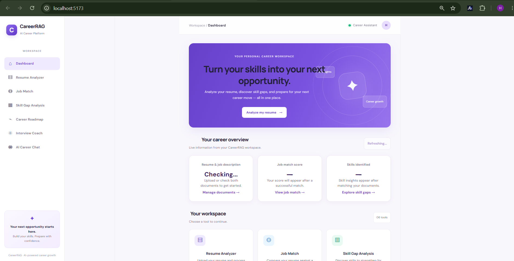
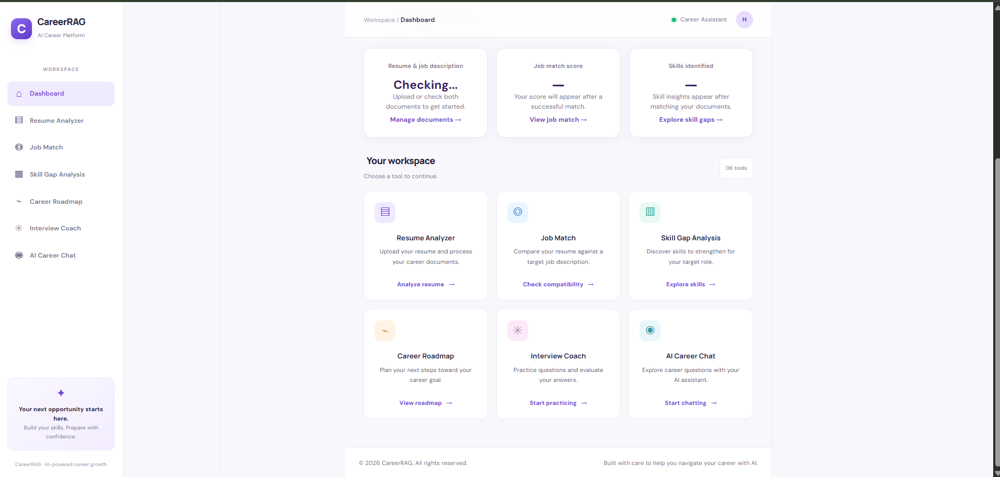
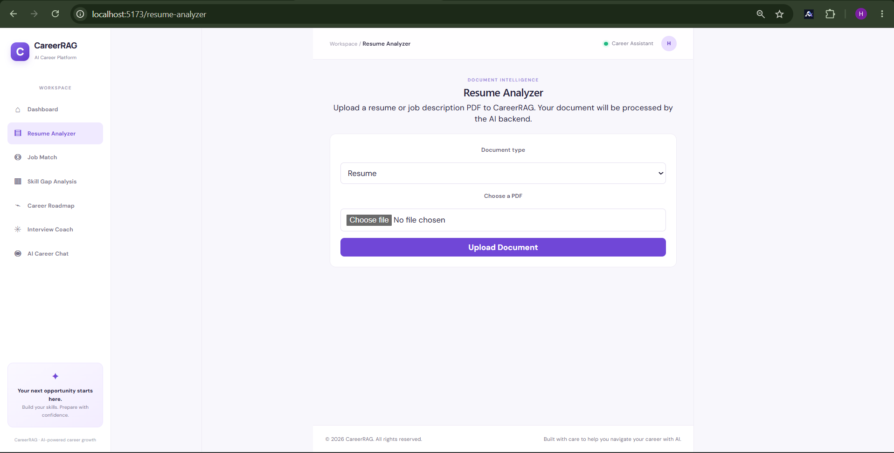
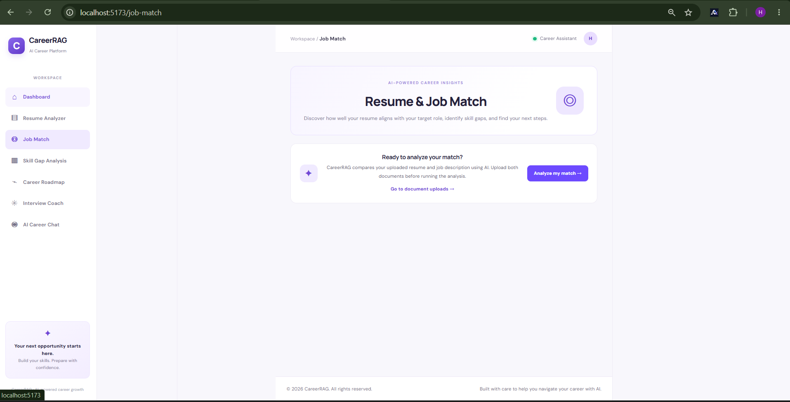
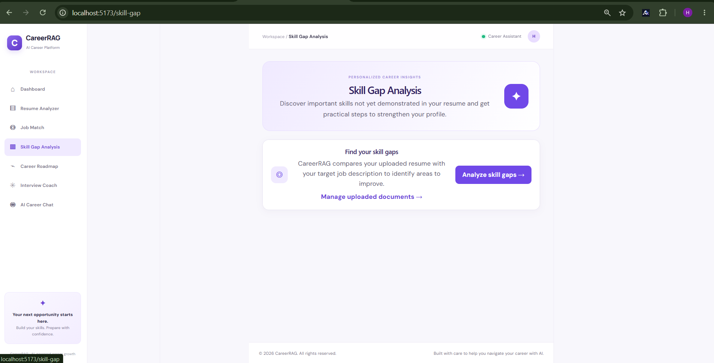
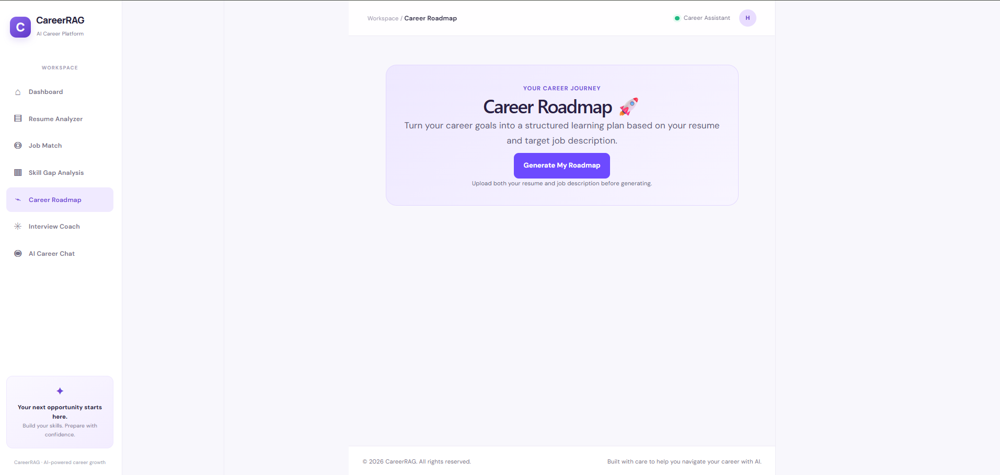
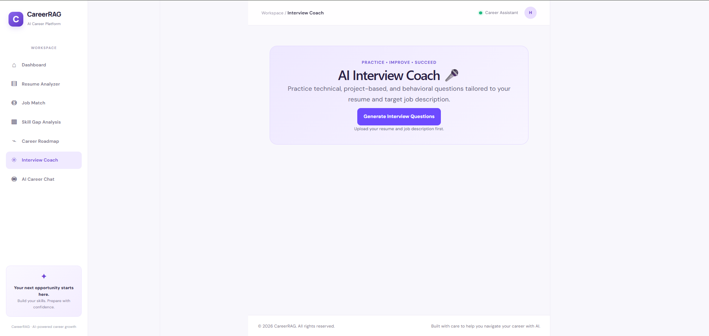
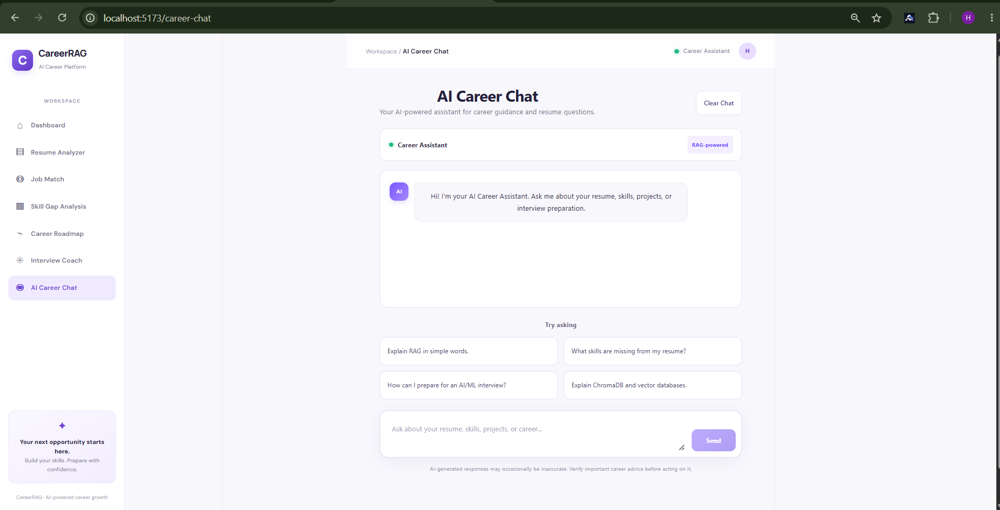
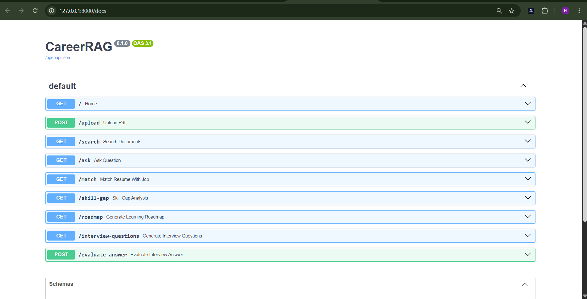
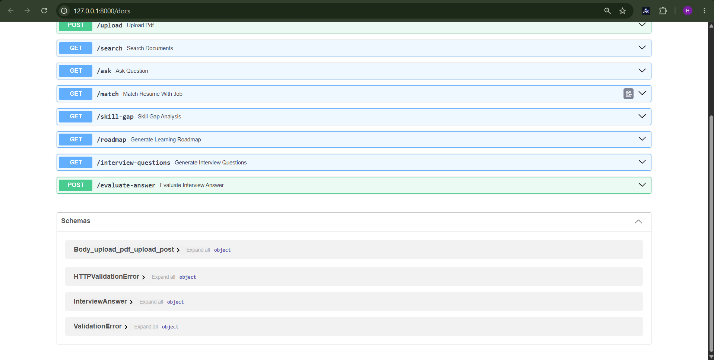

## 📸 Project Screenshots

### Home Page


### Home Page


### Resume Analyzer


### Job Matching



### Skill Gap Analysis


### Career Roadmap



### Interview Coach


### AI Career Chat



### Swagger Up



### Swagger Down



# CareerRAG — AI Resume & Job Matching Assistant

CareerRAG is an AI-powered career assistant that helps users analyze resumes, match their skills with job opportunities, identify skill gaps, explore career roadmaps, and prepare for interviews.

The application combines retrieval-based matching and generative AI to provide personalized career insights and interview feedback.

## 📸 Screenshots

### Home Page


### Resume Analyzer


### Job Matching


### Interview Coach


### Career Roadmap


### Skill Gap Analysis


### AI Career Chat


## ✨ Features

- **Resume Analysis:** Analyze resume information and identify relevant skills.
- **Job Matching:** Compare resume skills with job requirements.
- **Skill Gap Analysis:** Identify skills that may need improvement for target roles.
- **Career Roadmap:** Explore potential learning paths and career development steps.
- **Interview Coach:** Evaluate interview responses and receive AI-generated feedback.
- **AI Career Chat:** Ask career-related questions and receive personalized guidance.
- **REST API Documentation:** Explore and test backend endpoints through Swagger UI.

## 🛠️ Tech Stack

**Frontend**
- React.js
- Vite
- JavaScript
- CSS

**Backend**
- Python
- FastAPI
- REST APIs

**AI and Data Technologies**
- ChromaDB
- Google Gemini API
- Retrieval-Augmented Generation (RAG) concepts

## 📂 Project Structure

```text
CareerRAG/
├── backend/
├── frontend/
├── AIcareerchat.png
├── careerroadmap.png
├── homepage1down.png
├── homepage1up.png
├── interviewcoach.png
├── jobmatch.png
├── resumeanalyser.png
├── skillgapanalysis.png
├── swaggerdown.png
├── swaggerup.png
├── requirements.txt
├── .env.example
├── .gitignore
└── start_careerrag.bat
```

## 🚀 Getting Started

### Prerequisites

- Python
- Node.js and npm
- A Google Gemini API key, if required by the configured AI features

### 1. Clone the repository

```bash
git clone https://github.com/10-harini/CareerRAG.git
cd CareerRAG
```

### 2. Install backend dependencies

From the project root, create and activate a virtual environment:

```bash
python -m venv .venv
```

On Windows PowerShell:

```powershell
.\.venv\Scripts\Activate.ps1
```

Install dependencies:

```bash
pip install -r requirements.txt
```

### 3. Configure environment variables

Refer to `.env.example` and configure the environment variables required by the backend. Add your own Gemini API key if needed.

Never commit real API keys, passwords, or secret credentials to GitHub.

### 4. Install frontend dependencies

```bash
cd frontend
npm install
cd ..
```

### 5. Run the application

On Windows, you can use the provided startup script if it is configured for your environment:

```text
start_careerrag.bat
```

Alternatively, follow the backend and frontend startup commands documented in their respective project directories.

## 🔌 API Documentation

CareerRAG uses FastAPI to provide backend API endpoints.

When the backend is running, open:

`http://127.0.0.1:8000/docs`

### Swagger UI Screenshots


## 💡 Example Use Cases

- Analyze a resume to identify skills and strengths.
- Compare a candidate's skills against a target job.
- Identify skills to learn for a desired role.
- Practise interview questions and review feedback.
- Explore possible career development paths.

The available results depend on the application's implementation, configured AI services, and supplied data.

## 🔮 Future Improvements

- Add more job sources and matching criteria.
- Improve resume parsing and skill extraction.
- Support exporting analysis reports.
- Expand interview practice and feedback features.
- Enhance the user experience and deployment options.

## 👩‍💻 Author

**Harini S**

B.Tech in Artificial Intelligence and Data Science

- GitHub: [10-harini](https://github.com/10-harini)
- LinkedIn: [Harini S](https://www.linkedin.com/in/harini-s-117836242)

## 📄 License

This project is intended for educational, portfolio, and demonstration purposes. Add a license file if you choose to distribute it under a specific open-source license.

